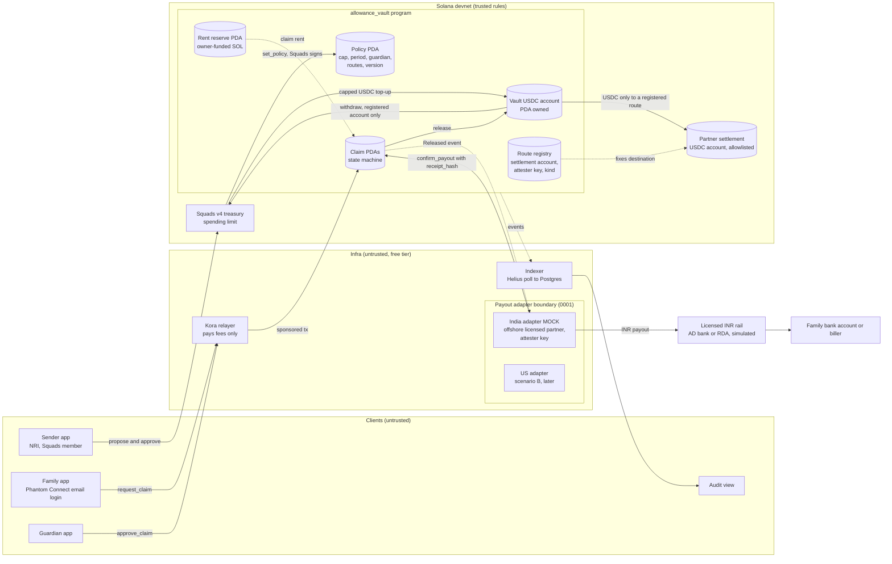
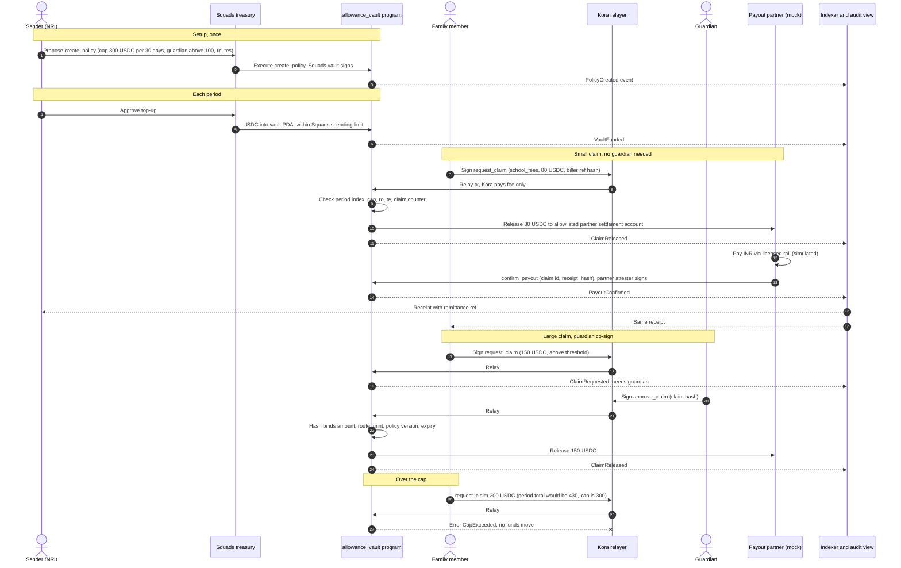
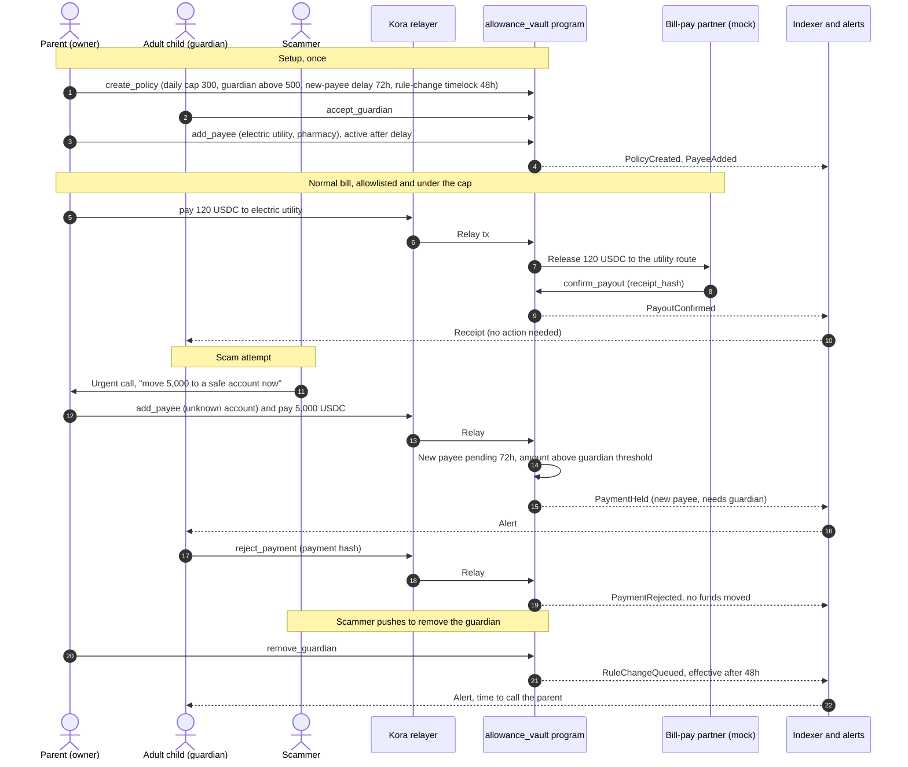

# 04 — Accounts and signers

> Status: diagram v1.1 draft (2026-11-11). Diagrams follow the proposed ADRs 0001–0010
> (`adr/README.md`), which are **not accepted yet**. v1.1 adds the payout adapter boundary (0001),
> route registry, rent reserve (0009) and withdrawal account (0008). D1: on the partner route family
> members never hold USDC; the vault pays only an allowlisted offshore partner. Fill the tables after
> the options ADRs. Post diagram v1 publicly, then each revision.
>
> **v2+ (2026-11-20), diagrams not redrawn yet:** (1) a second route kind, `WALLET`, pays USDC straight
> to the family wallet and is final at `Released`; (2) "Kora relayer" in the diagrams means the fee
> payer, a rate-limited serverless function in the hosted demo; (3) the payout worker is a Temporal
> workflow and the Postgres side is a double-entry ledger. Redraw in slice 3 with the program.

## Accounts
| Account | Owner program | Seeds | Size | Created by | Closed by |
|---|---|---|---|---|---|
| `[ ]` | | | | | |

## Who signs what
| Instruction | Signers | Writable accounts | Emits |
|---|---|---|---|
| `[ ]` | | | |

## Diagram v1 — architecture

Trusted: Squads program, this program's rules, the guardian's key. Untrusted: every client, the
Kora relayer, the indexer, the payout-partner mock, RPC.

## Diagram v1 — end-to-end sequence

Example numbers only: cap 300 USDC per 30-day period, guardian needed above 100 USDC.

Not shown yet: `Rejected`, `Expired`, `Cancelled`, sender revoke and withdraw (invariant 11),
guardian rotation timelock (D3), policy version bump (D6). Next: claim lifecycle as
`stateDiagram-v2`.

## Scenario B (second demo) — US elder money guardian

Same program, different role mapping. Design rule: the program knows **owner**, **spender**,
**guardian** and **payee routes**, never "India" or "US"; the market lives in the payout adapter.

| Role | Scenario A, India (primary) | Scenario B, US elder |
|---|---|---|
| Funds owner | Sender (NRI) via Squads | Parent, own vault (single key or Squads) |
| Spender | Family member files claims | Parent pays own bills |
| Guardian | Independent co-signer above threshold | Adult child: approve, reject or delay; never moves funds or edits payees alone |
| Payout adapter (mock) | Offshore partner → licensed INR rail | US card issuer or ACH bill-pay partner |
| Spender holds USDC? | No (D1, proposed) | Yes, adult in the US, hidden behind the app |

**Open design tensions (ADRs needed, security reasoning):**
1. **Invariant 11 vs scams.** "Owner can always withdraw" is exactly the scam path. Proposal:
   owner withdrawal goes only to a pre-registered own account; anything else is a new payee with
   the delay and guardian rule.
2. **Guardian can be the abuser.** A relative guardian must never redirect or withdraw. Proposal:
   guardian can only reject or delay, and a rejected payment can be resubmitted after a longer
   delay without the guardian, so an active veto can't freeze the owner forever.
3. **Coerced rule changes.** Removing the guardian or raising caps goes through a timelock with an
   alert, not instant.
4. **Spender = owner in B, spender = beneficiary in A.** Model one `spender` role in the claim
   state machine so both scenarios share handlers.
