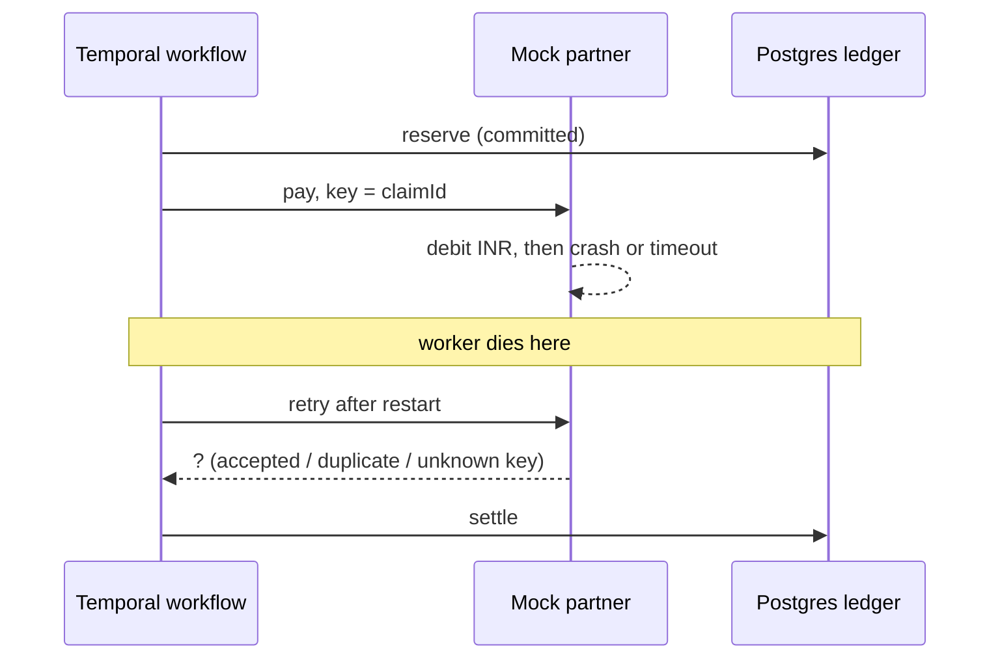

# 09 — Open questions (with the system design behind each)

> Status: **2026-11-20.** Every gap found so far in the architecture, in one list for you to answer.
> OQ-01 to OQ-13 come from the v2+ review (findings R12–R21 on the architecture page). OQ-14 to
> OQ-21 are specification gaps found while writing [08-requirements](08-requirements.md). OQ-22 to
> OQ-33 are questions already open in the older ADRs and review (R1–R11), collected here so nothing
> is lost.
>
> **How to use this:** for each question, read the lesson, then write your answer under
> **Your answer** in your own words. Don't edit the ADRs yet. Once a group is answered, those answers
> become ADR text. Per CLAUDE.md, the answers are yours; I only explain and compare options.
> Architecture changes come after you answer.

## Suggested order
1. **Before ADR 0011 (payout architecture):** OQ-01, 02, 03, 20.
2. **Before ADR 0012 (ledger model):** OQ-04, 05, 07, 14 (ledger side), 17.
3. **Before slice 3:** OQ-22 to OQ-29, OQ-06, OQ-18, OQ-19.
4. **Before slice 4:** OQ-08 to OQ-13, OQ-21.
5. **Anytime, they don't block code:** OQ-15, 16, 30 to 33.

## Index
| ID | Question in one line | Priority | Blocks |
|---|---|---|---|
| OQ-01 | After a crash, which record says whether money already left? | High | ADR 0011, S1 |
| OQ-02 | What ties one user intent to one claim? | High | ADR 0011, S3 |
| OQ-03 | What delivery guarantee does the workflow's input promise? | High | ADR 0011, S1 |
| OQ-04 | Can the conservation rule be stated without "held"? | High | ADR 0012 |
| OQ-05 | Which states may move backwards, and does a refund restore the cap? | Medium | ADR 0012, S2 |
| OQ-06 | How do long-running workflows survive code changes? | Medium | S2 |
| OQ-07 | When is the FX rate locked and who pays a move? | Medium | ADR 0012, S2 |
| OQ-08 | What does the one-browser demo prove? | Medium | S4 |
| OQ-09 | How is the fee-payer and mint endpoint protected? | Medium | S4 |
| OQ-10 | Which UI actions may be optimistic? | Medium | S4 |
| OQ-11 | Where is per-role row access enforced? | Medium | S4 |
| OQ-12 | What does "exactly once" prove, and what not? | Low | S1 README |
| OQ-13 | How do you know a claim is stuck? | Low | S2 |
| OQ-14 | Instant tightening, delayed loosening for rule changes? | Medium | S3 |
| OQ-15 | How long is the scenario B veto-expiry delay? | Low | S3 |
| OQ-16 | What latency and throughput targets, if any? | Low | NFR |
| OQ-17 | What data is kept, for how long, and how is it deleted? | Medium | ADR 0012 |
| OQ-18 | Which token programs and mints are supported? | Medium | S3 |
| OQ-19 | How long do claims and approvals live? | Medium | S3 |
| OQ-20 | What exactly is the mock partner's contract? | High | ADR 0011 |
| OQ-21 | How do family members onboard and recover keys? | Medium | S4 |
| OQ-22 | D1: option 3 or 5, and which Squads product? | High | S3 |
| OQ-23 | Which single policy is the spender's only path? (R1) | High | S3 |
| OQ-24 | What binds the hook call to this family's account? (R2) | High | S3 |
| OQ-25 | Where does the guardian's approval live? (R3) | High | S3 |
| OQ-26 | Which side is the authority on the cap? (R5) | Medium | S3 |
| OQ-27 | How does the indexer know it missed an event? (R6) | Medium | S3 |
| OQ-28 | Should removing trust be as slow as granting it? (R8) | Medium | S3 |
| OQ-29 | Who pays claim rent? (ADR 0009, test 8) | Low | S3 |
| OQ-30 | Which legal points need a CA before public copy? | Medium | posts |
| OQ-31 | Enter Colosseum Eternal, and when? | Low | planning |
| OQ-32 | Accept ADRs 0001–0010, with which changes? | Medium | S1 start |
| OQ-33 | Does any sender actually want this? | Low | optional |

---

# Part A — From the v2+ review (R12–R21)

## OQ-01 · After a crash, which record says whether money already left? (R12)
**Concept: the dual-write problem and "source of truth".** Whenever one action touches two systems
(here: the partner and your database) there is a moment where one has changed and the other hasn't.
A crash in that gap leaves them disagreeing. Systems that retry (Temporal does, by design) make this
worse: retrying is only safe if you can tell "did the first attempt work?" The usual tools are
(a) **write your intent before acting**, so you can see "I was about to pay", (b) **ask the other side**
what it did before you retry, and (c) **idempotency keys**, so the other side recognises a repeat.

**Why it matters here:** this is the exact test slice 1 must pass ("timeout after debit, retry, one
payout").
**Think about:**
1. After a restart, which of the three records (Temporal history, ledger, partner) do you trust first?
2. If the partner says "unknown key", is paying again safe? What would the partner have to guarantee?
3. What does the ledger show for a payout whose outcome is unknown?

**Options:** intent-first then query status before retry · treat the partner's idempotency record as
the only authority · rely on nightly reconciliation.
**Your answer:**
> temporal history tells us that workflow ran and execution related insights..
> ledger holds the truth so it should have status of the transaction.
> partner can tell us but it can timeout or go down..
>
> so we trust our ledger first.
>
> unknown key is unsafe, so ask partner first and wait
>
> payout_unknown, funds stay reserved until partner answers

*Refinement (added by Claude, you accepted it, 2026-11-24):* the ledger is the truth about what we
intended and what we have learned so far, not about whether money left; it says "reserved, outcome
unknown" until the partner answers. Order: ledger first (where does this claim stand), partner next
(did money move), Temporal only for what the workflow was doing.

*Direction decided in chat (2026-11-23):* block the payout until the partner is asked.

*Complete:* all three questions answered 2026-11-24. The "not found" window (15 minutes default) and
the slice 1 test plan are in ADR 0011.

## OQ-02 · What ties one user intent to one claim? (R13)
**Concept: idempotency at different layers.** An idempotency key makes *the same request* safe to
repeat. But a user who taps again after a timeout may produce a *different* request (a new signature,
a new counter value). So you need a stable identity for the **intent** that is created before any
attempt and carried through every attempt. Compare: a counter protects against *reuse of an id*, not
against *two ids for one wish*.
**Think about:**
1. Who creates the intent's id: the client, the app server, or the program?
2. If the app crashes between "user taps" and "transaction sent", how does a retry find the intent?
3. If you accept duplicates, how large is the worst case (hint: the cap)? Is that acceptable?

**Options:** client-generated request id stored in the claim · per-intent nonce in instruction data
· accept duplicates, bounded by the cap.
**Your answer:**
> server generates id, resume automatically after crash
>
> worst case bounded by cap, acceptable

*Direction decided in chat (2026-11-23, not your dictated words):* the natural key is (vault,
recipient, currency, amount, period) while the intent is open, route not in the key; cap enforced
atomically with the reserve as the backstop.

*Complete:* all three questions answered 2026-11-24.

## OQ-03 · What delivery guarantee does the workflow's input promise? (R14)
**Concept: delivery semantics.** A message source can promise *at-most-once* (may lose), *at-least-once*
(may repeat) or *exactly-once* (practically means at-least-once plus de-duplication). It can also
promise *ordering* or not. Real chain indexers are at-least-once, unordered and can have gaps. If
you design the consumer against a better-behaved fake, you will rewrite it when the real source
arrives. The **contract** is the architecture; the fake is just a test double.
**Think about:**
1. Write the contract in one sentence per property: duplicates? ordering? gaps? late arrival?
2. Which of those should the fake source be able to inject so the tests prove the consumer copes?
3. Where does de-duplication live: in the source, the consumer, or the database key?

**Options:** configurable fake (duplicates, delays, gaps) from day one · a thin interface that states
at-least-once and unordered · build the real indexer first.
**Your answer:**
> events can repeat, arrive out of order, get lost, arrive late
>
> all four, database unique key plus workflow id

*Direction decided in chat (2026-11-23, not your dictated words):* the fake source injects
duplicates, delays, reordering and lost events from slice 1; de-duplication in the workflow id
(derived from `claimId`) and a unique key on the claim row; a duplicate for a running workflow is
logged and ignored.

*Complete:* all three questions answered 2026-11-24.

## OQ-04 · Can the conservation rule be stated without "held"? (R15)
**Concept: invariants should survive design changes.** An invariant is a statement that stays true
after every step. If its wording depends on an undecided design choice (funds in a program vault, or
in the sender's smart account), it will break when you decide. Good invariants talk about **flows
between named accounts**, not about where a balance happens to sit. Double-entry bookkeeping works
because every entry moves value from one account to another, so a sum over all accounts is always
zero.
**Think about:**
1. List the ledger accounts that exist under option 3, then under option 5. Which are common?
2. What does the ledger record when the sender's USDC is in a smart account you don't control?
3. Can "funded" be defined as an event rather than a balance?

**Options:** model only released and refunded flows · a "reserved" account common to both options ·
decide D1 earlier.
**Your answer:**
> reserved, released, refunded flows; funded is an event
>
> reserved funds ?

*Clarification (added by Claude, you accepted it, 2026-11-24):* reservations against the sender's
limit, not a balance we hold. The sender's money stays in their own account; the ledger records what
is committed to a claim, and the on-chain limit is what actually protects it.

*Direction decided in chat (2026-11-23, not your dictated words):* refunded is its own account;
checked per claim and per period; funds sit in the sender-owned Squads smart account with limits
(the final D1 pick stays in slice 3); "funded" references the on-chain limit.

*Complete:* all three questions answered 2026-11-24.

## OQ-05 · Which states may move backwards, and does a refund restore the cap? (R16, R11)
**Concept: terminal states vs. compensation.** In a state machine a terminal state means "nothing
more happens". Real money processes aren't that tidy: a bank can reverse a payment days later. The
accounting answer is *never edit history; add a new entry that cancels the old one* (a compensating
transaction). The design question is whether the claim's *state* moves, or whether a separate
*reversal record* sits next to a state that stays "paid".
**Think about:**
1. Is a reversal an event on the claim, or its own object? What does the audit view show?
2. After a refund, has the family "used" this period's cap? Argue both sides.
3. Who signs the on-chain transition, and what does the chain say while the ledger already refunded?

**Options:** a compensating state · a separate reversal record · a refund restores or doesn't restore
the cap (ADR 0006's open question).
**Your answer:**
> failed, settled, reversed final; restore cap on failure, current period
>
> restore cap only after refund settles in ledger

*Direction decided in chat (2026-11-23, not your dictated words):* `paid` moves to `settled` through
statement reconciliation; a late return after `settled` is a separate linked adjustment, so
`settled` stays final; a reversal after paid restores the cap only once the refund has settled in
the ledger.

*Complete:* all three questions answered 2026-11-24.

## OQ-06 · How do long-running workflows survive code changes? (R16)
**Concept: durable execution and determinism.** Temporal workflows are replayed from their event
history after a crash or restart. For replay to work, the workflow code must make the same decisions
given the same history, so you can't freely change code while a workflow is in flight. A workflow
that waits days for a reversal will outlive several deploys. Also, histories grow; long ones need to
be cut and continued.
**Think about:**
1. Does a payout workflow end at "settled", or stay open for the reversal window?
2. If it stays open, what happens to in-flight workflows when you change the code?
3. Could a separate scheduled job per claim replace the long wait? What do you lose?

**Options:** short workflow plus a separate reversal workflow · long-lived workflow with versioning ·
scheduled checks.
**Your answer:** `[YOU]`

## OQ-07 · When is the FX rate locked and who pays a move? (R17)
**Concept: exposure window.** Any gap between "committed" and "settled" is a risk window. Count the
steps in your gap: chain finality, indexer polling lag, workflow scheduling, partner processing. The
longer the gap, the more a price can move, and someone must carry that risk: the sender, the family,
or you. Real systems shorten the window, lock the price early, or hold the transaction.
**Think about:**
1. Write the worst-case gap in seconds with each contributor named.
2. Is the quote bound to the claim before USDC leaves, or after?
3. If the rate moves past tolerance after USDC has gone, who pays the difference? Does the family
   have to re-confirm something that already left the sender's account?

**Options:** quote before release and bind it · re-quote after, sender absorbs · hold until confirmed.
**Your answer:**
> quote before USDC leaves; sender carries it; 1% tolerance
>
> leave it as placeholder until slice 2

*Direction decided in chat (2026-11-23, not your dictated words):* quote lifetime 60 seconds,
configurable per route; past tolerance or expired before the payout starts, the claim is held and
the family re-confirms; once the payout has started on a valid quote the sender carries any later
move; FX risk is a versioned per-route `QuotePolicy`, snapshotted on the claim.

*Placeholder (your call, 2026-11-24):* question 1, the worst-case gap per contributor (chain
finality, indexer lag, workflow, partner rail), is left open until slice 2, when the FX policy is
built and a demo rail is chosen. Questions 2 and 3 answered.

## OQ-08 · What does the one-browser demo prove? (R18)
**Concept: threat model of a demo.** A trust boundary is a line between parties who don't fully trust
each other. A demo that holds all roles' keys in one place erases the boundary it's supposed to show.
That isn't wrong for a demo, but the page must say what it shows (the *rules and flow*) and what it
doesn't (that the guardian is a separate, independent party).
**Think about:**
1. What is the one sentence the demo is meant to prove?
2. What would a sceptical reviewer conclude from a one-browser run?
3. Is a separate guardian link (open in another tab or phone) cheap enough to do?

**Options:** label as a simulation · separate sessions per role · guardian invitation link.
**Your answer:** `[YOU]`

## OQ-09 · How is the fee-payer and mint endpoint protected? (R18, R7)
**Concept: abuse of public endpoints with a funded key.** Anything that spends on behalf of
unauthenticated visitors can be drained. Controls: rate limits (per IP, per wallet), spend ceilings
on the key, allowlisting what the key signs, and a plan for when it runs out. Also a single key is a
single point of failure: when it is empty, every family claim fails.
**Think about:**
1. How much devnet SOL can an attacker burn per hour with your limits?
2. What does a visitor see when the fee payer is empty?
3. What is the worst thing the "Fund demo" mint can do (hint: it's your own test mint)?

**Options:** per-IP and per-wallet limits plus a spend ceiling · stateless checks only · two keys
with failover.
**Your answer:** `[YOU]`

## OQ-10 · Which UI actions may be optimistic? (R19)
**Concept: optimistic updates.** The UI assumes success and shows the result at once, then rolls back
if the server says no. It feels fast but is wrong for anything where "it looked done" matters. Money
state is the worst case. Rule of thumb: optimistic for reversible local things; honest "pending"
for anything with a real-world consequence.
**Think about:**
1. List your UI actions: which are reversible? Which touch money?
2. What does the user see when a transaction expires (blockhash) after you showed it as sent?
3. How do "optimistic" and "honest pending states" (both in slice 4) fit together?

**Options:** optimistic only for non-money actions · show "submitted" instead of "done" · poll to
confirm before showing success.
**Your answer:** `[YOU]`

## OQ-11 · Where is per-role row access enforced? (R19)
**Concept: authorization at the data layer.** If a sync engine streams database rows to clients, the
rules about *who may see which row* must be enforced **before** the data leaves the server. Doing it
in the UI is not enforcement; the data is already on the device. Typical placement: a proxy in front
of the sync service that applies a per-user filter.
**Think about:**
1. For each role (Sender, Family, Guardian, Audit), which rows and columns may it read?
2. Where does a bank reference or beneficiary name live, and who must not see it?
3. What happens if the proxy is bypassed?

**Options:** per-role filters in an auth proxy · separate views in the database · fall back to
polling an API that filters.
**Your answer:** `[YOU]`

## OQ-12 · What does "exactly once" prove, and what not? (R20)
**Concept: stating the failure model.** Every reliability claim is about a *set of failures*:
"survives a worker crash" is not "survives a server loss". Honest systems write the set down. This
is also what interviewers probe.
**Think about:**
1. List the failures your S1 tests inject. List the ones they don't (Temporal server, Postgres,
   network partition, partner lying).
2. How does the README word the boundary?
3. Is a server-restart test worth adding?

**Your answer:** `[YOU]`

## OQ-13 · How do you know a claim is stuck? (R21)
**Concept: observability.** The three tools are logs (what happened), metrics (how often, how long),
and traces (which path). For money, the practical need is **age of the oldest non-terminal item**:
if a claim sits in "submitting" past an expected time, a human must be told. Workflow timeouts and a
"needs attention" list are the cheap versions.
**Think about:**
1. What is the longest a claim should sit in each non-terminal state?
2. Who is told when it's exceeded, and how?
3. Does the Audit view show stuck claims to the sender?

**Your answer:** `[YOU]`

---

# Part B — Specification gaps found while writing the requirements

## OQ-14 · Instant tightening, delayed loosening for rule changes? (ADR 0007, R8)
**Concept: asymmetric safety changes.** A change that makes the system *safer* (lower cap, revoke a
key) can safely take effect at once; a change that makes it *riskier* (raise cap, add a payee) is the
one an attacker or coercer wants, so it gets the delay. Symmetric delays slow down emergency response.
**Think about:** which changes tighten? Can an attacker abuse "instant" (for example by freezing the
family)? What does the family see?
**Your answer:**
> tightening instant, loosening 24 hours, guardian can undo
>
> pending changes visible to everyone with cancel option

*Direction decided in chat (2026-11-23/24, not your dictated words):* tightening = lower cap, shorter
period, remove payee, revoke key, pause; loosening = raise cap, add payee, add key, extend period,
resume, remove guardian (this one waits 7 days); a mixed change counts as loosening; loosening
applies mid-period; sender and guardian can each cancel a pending loosening; the guardian's instant
undo restores only the rule version in force before the first tightening of the lockout; a stolen
sender key can freeze the family, which the guardian undoes.

*Clarification (added by Claude, you accepted it, 2026-11-24):* everyone sees a pending change, but
only the sender and the guardian can cancel it; the family member sees it and cannot cancel.

*Complete:* all three questions answered 2026-11-24.

## OQ-15 · How long is the scenario B veto-expiry delay? (ADR 0004)
**Concept: protecting against the protector.** A guardian who can veto forever can also abuse that
power over an elderly owner. Making the veto expire after a delay keeps the owner in control. Too
short and a scammer waits it out; too long and the owner is stuck.
**Think about:** what delay would stop a typical scam (which relies on urgency)? Who is notified
during it?
**Your answer:** `[YOU]`

## OQ-16 · What latency and throughput targets, if any?
**Concept: non-functional targets come from the user, not the technology.** Without a number, "fast
enough" can't be tested. For a family allowance, correctness dominates; the useful numbers are
*time from claim to "sent"* and *time to confirmed*, not requests per second.
**Think about:** what time would feel acceptable to a family member? Is there any throughput number
worth testing at all, or is it "not applicable, stated"?
**Your answer:** `[YOU]`

## OQ-17 · What data is kept, for how long, and how is it deleted?
**Concept: append-only vs. the right to delete.** An immutable ledger and on-chain records conflict
with deleting personal data. The usual answer: keep personal data **out** of the immutable store
(only hashes, opaque ids) and in a separate mutable store you can erase.
**Think about:** where do names, bank references and phone numbers live? What does the ledger hold
about a person? What happens if a family member asks to be deleted?
**Your answer:**
> opaque ids in ledger, personal data in erasable store
>
> erase personal data row, ledger entries stay

*Direction decided in chat (2026-11-23, not your dictated words):* no names, phones, bank references,
free-text memos or personal hashes in the ledger, receipts, chain or logs; the partner holds the bank
reference and we keep only a partner-side token (`partnerToken`); deleting a person erases their row
in the erasable store and ledger entries stay (pseudonymization); retention period is a placeholder
for a CA or lawyer; a test checks that no ledger row, receipt or log line contains a name, phone or
bank reference.

*Retention (set by Claude at your request, 2026-11-24; project default, not legal advice):* ledger
records 8 years after the claim's final state, personal-data store erased on request or 12 months
after the vault closes, logs 90 days. Table in ADR 0012.

*Complete:* all three questions answered 2026-11-24.

## OQ-18 · Which token programs and mints are supported? (AGENTS, book ch 3, 7)
**Concept: token extensions change money semantics.** Newer token standards can add transfer fees,
pausing, permanent delegates and hooks that change what "transfer 80" does. A program that accepts
any mint inherits all of that.
**Think about:** USDC only, in S3? Your own test mint on devnet has none of these. When (if ever)
do you add another stablecoin, and what must be checked first?
**Your answer:** `[YOU]`

## OQ-19 · How long do claims and approvals live? (ADR 0004, 0006)
**Concept: timeouts are design decisions.** Every pending state needs an expiry, or it can hold a
resource forever. But the length trades safety (short) against convenience (long): a guardian who is
asleep, a family member waiting for school fees.
**Think about:** guardian approval window? Time to execute after approval? Pending claim lifetime?
Demo values (2-minute periods) vs. real values.
**Your answer:** `[YOU]`

## OQ-20 · What exactly is the mock partner's contract? (ADR 0010, FR-21)
**Concept: the contract is the architecture of an integration.** A mock that is too friendly teaches
your code nothing; one with a documented set of behaviours becomes a specification a real partner
can be compared against. Decide: endpoints, idempotency semantics (what does a repeated key return?),
webhook format, signature scheme and replay window, status values, quote shape and expiry, what
"timeout" means.
**Think about:** write the partner's API in one page. What happens on a duplicate key with a
*different* body? Are webhooks retried, and how? Is the receipt canonical form fixed (sorted keys,
amounts as strings)?
**Your answer:**
> as per defaults

*The defaults you accepted (2026-11-23, written out by Claude; full text in ADR 0011):*
- Endpoints: `POST /payouts`, `GET /payouts/{id}`, `GET /payouts?reference=<claimId>`. Quotes are slice 2.
- Strong mode (Stripe v1 semantics): `Idempotency-Key` up to 255 characters; same key and body replays the
  saved first response (including a 5xx once execution began); same key with a different body returns
  `409 idempotency_conflict`; a duplicate while the first is in flight returns `409 in_progress` with a
  retry hint; validation errors are not saved; key expiry configurable, default 24 h.
- Weak mode: no key honored; dedupe by `reference` only and it can fail; enquiry may return `not_found`
  for a configurable delay; a knob forgets a key or reference.
- Statuses: `pending | paid | failed | reversed`. `failed` is final; `reversed` is a separate state after `paid`.
- Webhooks: `payout.paid`, `payout.failed` (later `payout.reversed`); at-least-once, unordered, duplicated;
  exponential backoff up to 3 days (configurable); HMAC-SHA256 over the raw body plus a timestamp header;
  timestamps older than 5 minutes rejected.
- Timeout: the partner debits and then drops or never answers; the client timeout is a workflow setting.
- Receipt: signed by the partner (corrected 2026-11-23; the first default said "ours"); canonical form with
  sorted keys, fixed field order and amounts as strings in base units with an explicit currency; carries a
  `partnerToken`, not the bank reference.

*Complete:* answered 2026-11-24.

## OQ-21 · How do family members onboard and recover keys? (02-constraints)
**Concept: key custody is a usability problem.** Non-crypto users lose phones. Email-login embedded
wallets and passkeys trade control for recoverability. Whatever you choose changes what the program
trusts.
**Think about:** for the hosted demo, are browser-made wallets enough? For a real product, what
happens when a family member loses their device mid-claim?
**Your answer:** `[YOU]`

---

# Part C — Already open in the ADRs and the 16 Nov review (R1–R11)
Short entries; the full context is in the ADR or finding named.

## OQ-22 · D1: option 3 (own vault) or 5 (Squads hybrid), and which Squads product? (ADR 0002)
**Concept: build vs. integrate.** Integrating gets you maturity and a recognisable signal but ties you
to someone else's constraints and release schedule; building gives control and more code to defend.
Falsification tests (devnet tests 1–4) exist to settle this with evidence, not preference.
**Decision rule in the plan:** decided in slice 3; if slice 3 runs late, option 3.
**Think about:** which of tests 1–4 would change your mind? Which Squads product (v4 multisig or
smart-account program) after test 1? **Your answer:** `[YOU]`

## OQ-23 · Which single policy is the spender's only path? (R1)
**Concept: complete mediation.** A control only works if there is no way around it. If one policy
type has the hook and another doesn't, an additional policy silently creates a bypass.
**Think about:** how does the program or indexer prove no other policy lists the spender as a signer?
What does the indexer do when it sees an outflow with no claim? **Your answer:** `[YOU]`

## OQ-24 · What binds the hook call to this family's account? (R2)
**Concept: the confused deputy.** A trusted caller (Squads) can be tricked by a third party into
acting on your program with *their* inputs. The program must check that the call is about *its own*
recorded accounts, not merely that the right caller showed up.
**Think about:** which fields must the hook compare (vault authority, destination, config)? How do
you test the attack where a stranger's policy points at your program? **Your answer:** `[YOU]`

## OQ-25 · Where does the guardian's approval live, and which fields does it bind? (R3, ADR 0004)
**Concept: what a signature actually covers.** A signature binds exactly the bytes signed. If the
approval covers the transaction message but not the policy version or expiry, those can change
after approval.
**Think about:** put the extra fields inside the signed message, or keep a separate approval in your
program, or accept the weaker binding and write it down as a trust assumption? **Your answer:** `[YOU]`

## OQ-26 · Which side is the authority on the cap? (R5, ADR 0005)
**Concept: single source of truth.** Two systems that both enforce one limit will eventually disagree
at the edges (the exact boundary second, a change applied at different times).
**Think about:** Squads only · mirror and assert · one change applied atomically to both? What
happens to a claim at `t = anchor + period`? **Your answer:** `[YOU]`

## OQ-27 · How does the indexer know it missed an event? (R6)
**Concept: gap detection.** Polling with a cursor can skip silently. Systems add a per-stream
sequence number (a gap means backfill), a periodic sweep of on-chain state, or an overlap window made
safe by idempotent ingest.
**Think about:** which fits free-tier limits (about 10 requests per second)? How do you test a missed
page? **Your answer:** `[YOU]`

## OQ-28 · Should removing trust be as slow as granting it? (R8, ADR 0007, 0010)
Related to OQ-14, applied to the partner's attester key: rotation is a queued change, so a stolen key
can lie for 48 hours. **Think about:** instant revoke with delayed add? Pause freezes `confirm_payout`?
Keys with an expiry the partner renews? **Your answer:** `[YOU]`

## OQ-29 · Who pays claim rent, and does a first claim work with zero SOL? (ADR 0009, test 8)
**Think about:** run falsification test 8 before accepting 0009; measure rent vs fees. What is the
fallback if PDA-funded creation fails (fixed-size ring in the policy account)? **Your answer:** `[YOU]`

## OQ-30 · Which legal points need a CA before any public copy? (02-constraints)
**Concept: claims you can't back up.** Legal statements in public posts or a README are claims; if
unchecked they can mislead.
**Think about:** the licence routes (AD bank wire, RDA, MTSS; PA-CB as separate), the wallet-route
wording (devnet only), FEMA/tax lines. Which sentences stay out of public copy until a CA reviews?
**Your answer:** `[YOU]`

## OQ-31 · Enter Colosseum Eternal, and when? (TASKS)
A 4-week sprint that must start by 2027-03-20; the plan suggests slices 3–4 or CardLine could be it.
**Think about:** start when coding starts, not before; which scope would you submit? **Your answer:** `[YOU]`

## OQ-32 · Accept ADRs 0001–0010, with which changes? (TASKS)
All ten are *proposed*. For each, accept, change or reject. Slice 1 only needs 0001, 0003, 0006 and
0010 to be stable enough to build against; the rest can wait. **Your answer:** `[YOU]`

## OQ-33 · Does any sender actually want this? (business page, kill-rule)
**Concept: validate before you scale.** The design is solving imagined problems until someone with
the problem says so. The notes' own rule: 10 conversations; if fewer than 2 name a price, stop.
This is optional for a portfolio build but changes how you describe it publicly.
**Think about:** who are the first three people you'd ask? **Your answer:** `[YOU]`

---

## System-design ideas you've now met (quick glossary)
| Idea | Where it showed up |
|---|---|
| Dual-write problem | OQ-01 |
| Idempotency (and its limits) | OQ-02 |
| Delivery semantics (at-most/at-least/exactly once) | OQ-03 |
| Invariants and double-entry bookkeeping | OQ-04 |
| Compensating transactions, saga | OQ-05 |
| Durable execution and determinism | OQ-06 |
| Exposure window | OQ-07 |
| Trust boundary | OQ-08 |
| Abuse of public endpoints | OQ-09 |
| Optimistic updates | OQ-10 |
| Authorization at the data layer | OQ-11 |
| Failure model | OQ-12 |
| Observability | OQ-13 |
| Asymmetric safety changes | OQ-14, OQ-28 |
| Build vs integrate | OQ-22 |
| Complete mediation, confused deputy | OQ-23, OQ-24 |
| What a signature binds | OQ-25 |
| Single source of truth | OQ-26 |
| Gap detection | OQ-27 |
