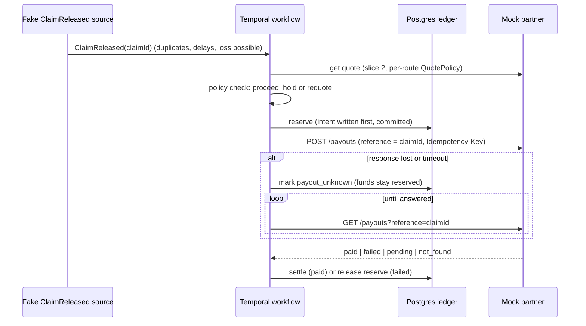

# 0011 — Off-chain payout architecture (Temporal workflow, mock partner, idempotency)

- **Status:** accepted
- **Date:** 2026-11-23 (accepted 2026-11-24)

> Draft written by the AI from your decisions. Your own dictated answers are in
> `../09-open-questions.md` (2026-11-24); you accepted this text on 2026-11-24. Items marked `[YOU]` or "proposed" inside stay open.

## Context
The partner route pays INR through a licensed partner. Paying involves two systems that cannot
change together: our database and the partner. A crash between "partner debited" and "ledger
settled" leaves them disagreeing, and Temporal retries by design, so after a restart the workflow
will call the partner again. Retrying is only safe if the system can tell whether the first
attempt worked (OQ-01). The same slice must also cope with a source that repeats, reorders and
loses `ClaimReleased` events (OQ-03), and with a user who taps twice (OQ-02).

Constraints: slice 1 is off-chain only; the partner is a mock (legal guardrail); free-tier
hosting; invariants L1 (paid at most once), L2 (balanced, append-only) and L3 (key replay with a
different request is rejected) in `../05-invariants.md`.

## Options
1. **Intent first, then ask the partner before any retry.** The ledger records the intent before
   acting; after an unknown outcome the workflow enquires, waits out a consistency window, and only
   then retries with the same reference. Cost: needs a status endpoint and a wait window.
2. **Treat the partner's idempotency record as the only authority.** Simple, one source of truth.
   Cost: fails when the partner is lossy or its key expires (24 h or more), and leaves no local
   audit trail.
3. **Rely on nightly reconciliation.** Cheap. Cost: money can sit in limbo for hours and a double
   pay is found after the fact.

Partner shape: build our own mock with a Stripe-convention API, or integrate real Stripe. Stripe's
India pages describe invite-only access and its cross-border payouts page marks US-only (search
results read 2026-11-23, not confirmed with Stripe), and a real partner cannot be made to time out
after a debit on demand. Sources: Stripe idempotent requests (`docs.stripe.com/api/idempotent_requests`),
Stripe cross-border payouts and India pages. India support for Stripe, Deel and Skydo is unconfirmed.

## Decision
**Option 1**, with partner idempotency as a second layer and reconciliation (slice 2) as the
backstop.

**Flow per claim** (`PayoutWorkflow`, one execution per claim, workflow id `payout-<claimId>`):



**Rules**
- **Block until asked.** After an unknown outcome the workflow does not retry the pay call until
  the partner has answered an enquiry. The ledger shows `payout_unknown`, never failed or settled,
  and funds stay reserved.
- **"Not found" is not final** until a window has passed (configurable per partner; default 15
  minutes for the mock, seconds in tests). Before that it counts as pending. A retry of the pay call
  is allowed only after the window, with the same reference.
- **If the partner cannot be asked,** the payout waits and alerts. It never falls back to paying
  again.
- **Order:** quote, check, reserve, pay. Re-confirmation is only possible before release.

**Identity of one wish (OQ-02).** The server generates an opaque intent id (UUID). Find-or-create
on the natural key `(vault, recipient, currency, amount, period)` while the intent is open (a
partial unique index), so a re-tap or a retry after a crash returns the same intent. The route is
not in the key: a failed partner route retried through the wallet route stays one intent.
*Accepted 2026-11-24, implemented in slice 3 (backlog):* because of that, an intent switches route
only after the first route's payout is definitely failed (the partner has answered and the "not
found" window has passed), otherwise a double payout across routes is possible. Ids from a client are untrusted: unique on `(user, id)`, ownership checks on every call, and the id never grants authority. The cap is enforced atomically with the reserve
as the backstop. Fields excluded from the key because they change on a retry: time, request id,
memo, device.

**Input contract (OQ-03).** `ClaimReleased` is at-least-once, unordered, may have gaps and arrive
late. The fake source is configurable (duplicates, delays, reordering, lost events) from slice 1.
De-duplication lives in two independent places: the workflow id derived from `claimId` (a second
start is rejected) and a unique key on the claim row. A duplicate for a running workflow is logged
and ignored. Slice 1 proves a dropped event causes no payout and a later redelivery pays once;
noticing a lost event is slice 2 reconciliation.

**Mock partner contract (OQ-20).** Own mock, Stripe-convention API, with two modes in slice 1.
- Stripe-convention fields: `Idempotency-Key`, a `metadata` object (carries `claimId`), `payout.*`
  event names.
- Endpoints: `POST /payouts`, `GET /payouts/{id}`, `GET /payouts?reference=<claimId>`.
- Strong mode (Stripe v1 semantics): `Idempotency-Key` up to 255 characters; same key and body
  replays the saved first response (including a 5xx once execution began); same key with a
  different body returns `409 idempotency_conflict`; a duplicate during an in-flight request
  returns `409 in_progress` with a retry hint; validation errors are not saved; key expiry is
  configurable, default 24 h.
- Weak mode (bank-style): no key honored, dedupe by `reference` only and it can fail; enquiry may
  return `not_found` for a configurable delay; a knob forgets a key or reference so a test can
  prove the ledger catches a double pay.
- Status values: `pending | paid | failed | reversed` (`reversed` used from slice 2). `failed` is
  final; `reversed` is a separate state after `paid`.
- Webhooks: `payout.paid`, `payout.failed` (later `payout.reversed`); at-least-once, unordered,
  duplicated; exponential backoff for up to 3 days (configurable); HMAC-SHA256 over the raw body
  plus a timestamp header; timestamps older than 5 minutes rejected.
- Timeout means the partner debits and then drops or never answers. The client timeout is a
  workflow setting, not a partner behaviour.
- Receipts are signed by the **partner**: its key signs `sha256(canonical receipt JSON)` (FR-26,
  ADR 0010). The mock uses its own attester key and every receipt says SIMULATED. Canonical form:
  amounts as strings in base units with an explicit currency, sorted keys, fixed field order so the
  hash is stable. The receipt carries a `partnerToken`, not the bank reference: the partner holds the
  bank reference and resolves the token on request (OQ-17). A `CREDITED` receipt without a token is
  invalid. Limit: we cannot verify the bank leg ourselves; we trust the partner's signature and
  statement reconciliation (L6).

**Partner port (method names proposed).** Narrow and partner-neutral: `submit(intent) → reference`, `enquire(reference)`,
`events`. Each partner declares capabilities: `idempotencyKey`, `keyTtl`, `enquiryConsistency`,
`eventSource`, `recipientOnboarding`, `steps`. The workflow reads them instead of forking. Stripe is
a style guide, not a dependency. No connected-account onboarding or two-step payout until a slice
needs it. An optional Stripe test-mode adapter may follow in slice 2 or 4 to show the port is real.

**FX risk (slice 2, OQ-07).** A versioned `QuotePolicy` returns decisions only (`proceed | hold |
requote | ledger adjustment`) and is configured per route. Its id, version and config are
snapshotted on the claim when the quote is bound. Slice 2 ships one policy only; no second policy or editor until needed, and the lock point moves
only within declared workflow shapes. Default policy: the quote is bound to the claim
before USDC leaves and expires; if it expires or the rate moves more than 1% before the payout
starts, hold and ask the family to re-confirm (L5); after the payout starts on a valid quote the
sender carries the move. This narrows L5 to "before release"; the L5 wording is amended in
`../05-invariants.md` (proposed). The core, not the policy, enforces conservation: any carried difference
is an explicit `fx_adjustment` ledger entry (ADR 0012). Quote lifetime defaults to 60 seconds, configurable per route.

```text
Not decided here: the real partner's rails, and whether slow rails need a cap on the sender's
exposure. Both defaults above are placeholders, not industry standards.
```

## Consequences
- **Easier:** the "timeout after debit, retry, one payout" test (FR-22) is a direct consequence of
  the rules; every partner is compared against one capability list; policy changes do not touch the
  workflow.
- **Harder:** `payout_unknown` needs a visible state and an alert; liveness depends on the partner
  answering; the weak mode adds test setup in slice 1.
- **Rules out:** blind retries, treating a timeout as failure, and relying on the partner's key
  alone.
- **Residual risk:** the rule cannot prevent a double pay if the partner is wrong after the window
  has passed. Reconciliation (slice 2, L6) is the backstop. State this in the README.
- **Open:** partner behaviour in this ADR comes from general knowledge and the Stripe docs; India
  support for Stripe, Deel and Skydo is unconfirmed. Workflow code changes while executions are in
  flight are an open problem (OQ-06, before slice 2).

## What would change this
- A real partner whose enquiry is never consistent, or that offers no way to look up by reference.
- Temporal history growth or cost becoming a problem at the volumes we test.
- A decision to use a real partner sandbox (then the capability descriptor is revisited).
