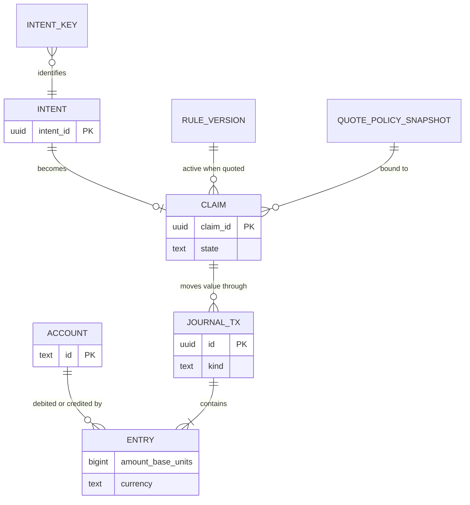

# 0012 — Ledger model (double-entry, append-only, idempotency table, base units)

- **Status:** accepted
- **Date:** 2026-11-23 (accepted 2026-11-24)

> Draft written by the AI from your decisions. Your own dictated answers are in
> `../09-open-questions.md` (2026-11-24); you accepted this text on 2026-11-24. Items marked `[YOU]` or "proposed" inside stay open.

## Context
The payout workflow (ADR 0011) needs a record of what we owe, what is in flight and what has
left, that survives crashes and retries and can be checked against the partner and the chain. The
old conservation rule, `funded = held + released + refunded` (L4), depends on an undecided design
choice: if the funds sit in the sender's Squads smart account (ADR 0002, option 5, the hybrid; the D1 pick is still made in slice 3) we never
"hold" them, so "held" has no meaning. An invariant worded around where a balance sits breaks when
that choice is made. It must talk about flows between named accounts instead (OQ-04).

Further forces: a failed payout and a late reversal must be told apart because they treat the
period cap differently (OQ-05); an FX move must land somewhere visible (OQ-07); the ledger is
append-only but people may ask for their data to be deleted (OQ-17); rule changes alter the cap
over time (OQ-14).

## Options
1. **Balances per account, updated in place.** Simple reads. Cost: no audit trail, and a crash or
   a bug silently changes history.
2. **Double-entry, append-only journal in Postgres.** Every entry moves value from one account to
   another; corrections are new entries. Cost: more rows and a little more care on reads.
3. **Event sourcing with projections.** Full history and flexible views. Cost: heavier than slice 1
   needs; YAGNI.

## Decision
**Option 2**: a double-entry, append-only journal in Postgres. Integer base units only (USDC 6
decimals, INR 2 decimals, `bigint`), never floats.

**Accounts (flow-based, location-free)**

| Account | Meaning |
|---|---|
| `authorized` | Amount the sender's rules allow in a period (set by the `AllowanceFunded` event) |
| `reserved` | Set aside for a claim, outcome not final (includes `payout_unknown`) |
| `released` | Paid out to a route |
| `refunded` | Returned to the sender; its own account, not folded into unused |
| `fx_adjustment` | Explicit difference when a rate moves and someone carries it |
| `unused` | Derived: `authorized` minus the other accounts. Not stored, computed per period |

"Funded" is an event, `AllowanceFunded(amount)`, that references the on-chain limit. It is not a
balance. Under the lean in ADR 0002 (sender-owned Squads smart account with limits) we never hold
funds: the ledger records reservations against a limit, not balances. If a vault PDA is chosen in
slice 3, it is used with devnet test tokens only, and the same accounts still apply.

**Conservation (replaces L4)**
- **Per claim:** each claim's reserved amount ends in exactly one of `released` or `refunded`
  (plus an `fx_adjustment` entry when a move is carried).
- **Per period:** `authorized = unused + reserved + released + refunded + fx_adjustment`. Because
  `unused` is the residual, this identity alone can never fail, so the tests assert what can: every
  journal transaction balances (L2), and `unused >= 0` (the period is never over-committed). The cap
  available to claim is `unused` plus refunds that are allowed to restore it (failed at once,
  reversed once settled), landing in the current period. **How a refund counts (default accepted
  2026-11-24):** a failed payout returns its reserve to `unused` at once; a reversal after paid posts
  `released → refunded` when the refund settles, and then a restoring entry returns that amount to
  `unused` in the current period. The cumulative `refunded` flow stays on the books for the audit
  trail; only the restore entry gives cap back.
- The core enforces both, whatever the FX policy decides, because any carried difference must be
  an explicit entry.

**Claim states (partner route).** `requested → reserved → payout_unknown? → paid → settled`, with
`failed` and `reversed` also possible. Final states: `failed`, `settled`, `reversed`. `paid` is not
final; `settled` stays final (a later return is a post-settlement adjustment, below).

**Mapping to FR-12 and ADR 0006 (decided).** Two separate steps: `PartnerConfirmed` means the
partner's signed receipt has arrived; `settled` means statement reconciliation has confirmed it
(slice 2; the slice 1 mock uses a short fixed window). The user sees "partner confirmed" at the
receipt; the ledger waits for the statement before calling it final.

| FR-12 state (on-chain, user-facing) | Off-chain sub-states |
|---|---|
| `Requested`, `Approved` | none: the payout has not started |
| `Released` | `reserved`, `payout_unknown`, `paid` (until the signed receipt arrives) |
| `PartnerConfirmed` | `paid` plus signed receipt; becomes `settled` after reconciliation |
| `PayoutFailed` | `failed` |
| after `PartnerConfirmed` | `reversed` and post-settlement adjustments, shown as events, not new FR-12 states |

**Balanced in the database (FR-32).** A deferred constraint trigger checks that the entries of a
journal transaction sum to zero per currency at commit.

**Append-only.** No `UPDATE` or `DELETE` on entries; the application role has no such grant.
Corrections are reversing entries. A claim's current state is derived from its entries, or kept in
a status table that is itself written only through a transition function.

**Idempotency table.** One row per `(scope, key)` with `request_hash`, `response`, `created_at` and
an optional expiry. Replaying a key with a different request hash is rejected (L3). A unique key on
the claim row (the natural key of ADR 0011, open intents only) is the second guard.

**Data model**

Each claim records the rule version that was active and the FX policy snapshot (id, version,
config) bound when the quote was made, so rules that change later never rewrite history.

**Privacy (OQ-17).** The ledger and chain hold only opaque ids, amounts and states. No names,
phone numbers, bank references, free-text memos or hashes of personal data. Personal data sits in
a separate erasable store keyed by an opaque person id; the partner holds the bank reference and we
keep a partner-side token. Deleting a person erases the mutable row (pseudonymization); ledger
entries stay. Retention (project default set 2026-11-24, **not legal advice**; a CA or lawyer must confirm
before any real deployment):

| Record | Kept | Why |
|---|---|---|
| Ledger entries, receipts, partner events (opaque ids, amounts, states) | 8 years after the claim's final state | Secondary sources cite 8 years under the Companies Act and 5 to 10 under bank and RBI rules; we take the longest commonly cited |
| Personal-data store (name, phone, partner token) | Erased on request; otherwise removed 12 months after the vault closes | Keep only while the purpose lasts; statutory records stay in the ledger under opaque ids |
| Application logs | 90 days | Logs carry no personal data (tested) and are not records of account |

Where a legal retention period applies to a record, it overrides an erasure request for that record,
which is why the ledger holds only opaque ids and erasure targets the personal-data store. A test
asserts that no ledger row, receipt or log line contains a name, phone or bank reference.

**Rule changes.** The rule is in ADR 0007 (update 2026-11-23) and FR-4: tightening instant,
loosening after one day. The ledger only records which rule version was active for each claim.

## Consequences
- **Easier:** the rule holds whether funds sit with the sender or in a vault; every unit is in one
  state, so tests can assert it with fast-check (L2, L4) after every step of a random fault
  sequence; an unknown outcome has an honest place (`reserved` / `payout_unknown`).
- **Harder:** reads need a derived state or a projection; corrections need new entries; per-claim
  and per-period checks both have to be written and kept in step.
- **Rules out:** in-place balance updates, floats, and personal data in any permanent record.
- **Open:** how the ledger references the on-chain limit before
  slice 3; sender exposure on slow rails.

## What would change this
- Choosing a vault PDA in slice 3, which changes where `authorized` is verified but not the
  accounts.
- A partner that reports only net balances, so per-claim reconciliation (L6) is impossible.
- A legal requirement to erase ledger rows, not only the personal data behind them.

## Addendum 2026-11-24: Postgres client
The TypeScript packages use `pg` (node-postgres) with hand-written SQL migrations. Reasons: the ledger invariants (append-only, balanced entries, idempotency-key uniqueness) live in the database as SQL, and a raw-SQL client keeps `FOR UPDATE`, `ON CONFLICT` and SQLSTATE `23505` handling visible and testable. Alternatives considered: `postgres` (porsager), Kysely, Drizzle. `int8` columns are parsed to `BigInt` in one place, so base units never pass through a float.

## Addendum 2026-11-24: as built in PR 1, and what is deferred
- **Idempotency table:** a global `key` primary key with `request_hash` and `txn_id`. No `(scope, key)` pair, no stored response and no expiry yet; those belong to the partner request keys in slice 2.
- **One posting path:** every posting takes the touched scopes locks in sorted order, claims the key, writes, then re-derives `unused` per scope and rolls back with `OverCommitted` if one went negative. This holds for generic postings too, so lowering `authorized` below what is reserved is refused.
- **Isolation:** each unit of work starts `READ COMMITTED` explicitly. Under REPEATABLE READ the snapshot is taken before the lock wait and two reserves could both pass the cap check (test 6e runs with that as the server default).
- **Database guards:** deferred balance check per currency with a two-entry minimum, closed transactions reject later entries, every table (accounts included) blocks UPDATE, DELETE and TRUNCATE, and `accounts.id` must equal `scope/kind`.
- **Deferred (slice 1 risk accepted):** the application connects as a superuser and table owner, so it could disable triggers (`session_replication_role`) or alter tables. The text "the application role has no such grant" is not yet true. Before any hosted deploy: migrate as the owner, run the app as a non-owner role with only SELECT and INSERT. Tracked in the private BACKLOG.
